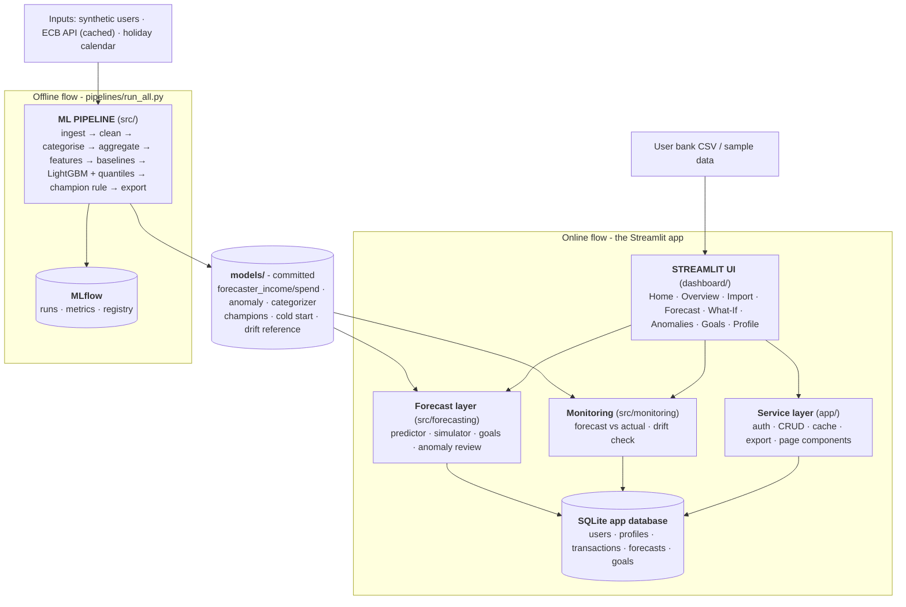
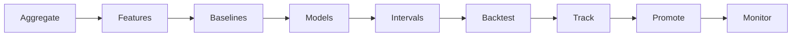
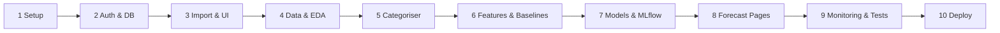

# FinCast - Predict Your Next Month's Income, Spending and Balance

> **Personal Finance Forecaster** - a full-stack machine learning and data science web app built in Python only.

Instead of only showing the past, **FinCast predicts next month's income, spending and balance, explains the numbers, and lets the user test decisions before making them.**

| | |
|---|---|
| **Type** | Full-stack machine learning and data science application |
| **Stack** | Python, Streamlit, SQLite, scikit-learn, LightGBM, MLflow, Plotly |
| **Editor** | VS Code (Python only) |
| **Delivery** | Deployed on Streamlit Community Cloud from GitHub |
| **Status** | Phases 1–9 built and tested; deployment (Phase 10) next - see [Roadmap](#10-implementation-roadmap) |
| **Tests** | 289 automated tests, 92 % line coverage, including an end-to-end pipeline run |
| **Live demo** | _Coming in Phase 10_ |

> **Disclaimer:** FinCast is a learning and portfolio project. Forecasts are statistical estimates based on past behaviour and are **not financial advice**.

---

## At a Glance

<table>
<tr>
<td width="50%"><br><sub><b>Forecast</b> - next month with a 10-90 % range</sub></td>
<td width="50%"><br><sub><b>How accurate was I?</b> - stored forecasts vs reality</sub></td>
</tr>
<tr>
<td><br><sub><b>What-If</b> - change next month, see the balance move</sub></td>
<td><br><sub><b>Overview</b> - where the money stands</sub></td>
</tr>
<tr>
<td><br><sub><b>Anomalies</b> - unusual or duplicate charges</sub></td>
<td><br><sub><b>Goals</b> - when will I get there?</sub></td>
</tr>
</table>

### Quick start

```bash
git clone https://github.com/OmPatil2806/FinCast-Predict-Your-Next-Month-s-Income-Spending-and-Balance.git
cd FinCast-Predict-Your-Next-Month-s-Income-Spending-and-Balance
python -m venv .venv
.venv\Scripts\activate            # Windows (macOS / Linux: source .venv/bin/activate)
pip install -r requirements.txt
streamlit run dashboard/Home.py    # the trained models are committed, so the app works right away
```

Register, open **Import transactions**, click **Use sample data** and save - then open **Forecast**.
To rebuild all data and models yourself: `python pipelines/run_all.py` (about 9 minutes). All commands: [Quick Start](#12-quick-start).

### Results in numbers

Measured on a rolling backtest over 23 months (Nov 2024 - Sep 2026), always training on the past only.

| What | Result |
|---|---|
| **Spending forecast** (total + 10 categories) | Champion system MAE **€55.23** vs **€59.33** for the best simple baseline everywhere (6.9 % lower); also lower on the later months it was not chosen on (€51.71 vs €58.81) |
| **Where the ML model wins** | Health **+23 %**, Leisure **+19 %**, Transport **+15 %**, Income **+11 %** vs the best baseline; everywhere else (rent, utilities, total spending, …) a baseline stays champion |
| **Forecast ranges** (10-90 %) | Real value inside the range **85 %** of the time for spending, **78 %** for income (target ≈ 80 %) |
| **Categoriser** | 100 % on held-out users and the sample file; on merchants it never saw, 42 % raw - the 22 % of guesses it is confident about are 91 % right, the rest go to review |
| **Anomaly flags** | 88 % of planted big costs, duplicates and price rises caught at 49 % precision; the Isolation Forest lost to a simple rule and only ranks |
| **Reproducibility** | A fresh clone + `run_all.py` reproduces every model and metric exactly |

> **Data honesty:** every number above comes from **synthetic** data (300 generated users, 36 months). Real users' accuracy is measured live by the *How accurate was I?* panel. See [Limitations](#13-limitations-and-risks).

---

## Table of Contents

0. [At a Glance](#at-a-glance) - screenshots, quick start, results
1. [The Problem](#1-the-problem)
2. [What FinCast Solves](#2-what-fincast-solves)
3. [What You Will Have at the End](#3-what-you-will-have-at-the-end)
4. [Data Sources](#4-data-sources)
5. [System Architecture](#5-system-architecture)
6. [Technology Stack](#6-technology-stack)
7. [Folder Structure](#7-folder-structure)
8. [Database Design (SQLite)](#8-database-design-sqlite)
9. [Machine Learning Pipeline](#9-machine-learning-pipeline)
10. [Implementation Roadmap](#10-implementation-roadmap)
11. [Implementation Phases, Step by Step](#11-implementation-phases-step-by-step)
12. [Quick Start](#12-quick-start)
13. [Limitations and Risks](#13-limitations-and-risks)
14. [Design Notes and Planned Improvements](#14-design-notes-and-planned-improvements)
15. [Final Launch Checklist](#15-final-launch-checklist)

---

## 1. The Problem

Most people can look back at their money but cannot look ahead. Banking apps list what was already spent. They do not say whether the account will run short before month-end, which categories are quietly growing, or whether a savings goal is realistic.

Income also differs by person. A salaried employee has an almost flat income, so the uncertainty sits in variable spending. A freelancer has irregular income, so the uncertainty sits on both sides. A single average does not help either of them.

### Where current tools fall short

- **No forward view.** History is shown, but next month's income, spending and balance are not.
- **Surprises at month-end.** Seasonal costs (holidays, insurance, annual fees) are forgotten and hit at once.
- **Manual categorisation.** Imported bank lines have messy merchant names, so category tracking is tedious.
- **Hidden anomalies.** Duplicate charges, forgotten subscriptions and one-off spikes go unnoticed.
- **No what-if thinking.** Users cannot test decisions such as cutting dining out or losing a client.
- **Goals without a date.** A savings target is set, but nobody can say when it will actually be reached.

---

## 2. What FinCast Solves

A logged-in user uploads past bank transactions (or types them in). The app cleans and categorises them, then uses a trained forecasting model to produce a range for the next month.

| Capability | What the user gets |
|---|---|
| **Next-month forecast** | Predicts income, total spending and spending per category with a lower/upper range. |
| **End-of-month balance** | Combines the forecasts into an expected balance and the risk of going below zero. |
| **Auto-categorisation** | Keyword rules first, then a text classifier (TF-IDF + logistic regression) for the rest. |
| **Anomaly detection** | Flags unusual or duplicated charges for review (a rule decides the flags, an Isolation Forest score ranks them - the rule won the comparison). |
| **What-if simulator** | Sliders such as "cut dining out by 20%" or "income drops 15%" recompute the forecast. |
| **Savings goals** | Projects the date a goal will be reached and whether the current pace is enough. |
| **Forecast accuracy** | Stores each forecast, fills in the real value later, and shows how accurate the app was. |
| **Accounts and privacy** | Login, hashed passwords, per-user data isolation and delete-my-data. |

### What the Forecast page shows

- Next month's income, spending and end-of-month balance, each with a 10-90 % range
- A warning when the balance is expected (or could, in a weak month) to go below zero
- A fan chart: the last 12 months and next month's range
- Every spending category with its forecast, range and the method that forecasts it best
- **How accurate was I?** - past forecasts against what really happened
- Notes for short histories (fewer than 6 or 12 months) and when the spending mix is far from the training data

---

## 3. What You Will Have at the End

- A working multi-page Streamlit web app with registration, login and private user data in SQLite.
- A complete, modular ML pipeline: ingestion, cleaning, categorisation, features, training, backtesting, tracking.
- MLflow experiment history that proves which model won and why, with a registered champion model.
- A live, shareable deployment on Streamlit Community Cloud, plus a GitHub repository with a clear README.
- A portfolio piece that shows end-to-end skills: data engineering, ML, time series, app development, MLOps basics.

### How we will know it works

| Measure | Target | Result |
|---|---|---|
| **Forecast quality** | The champion model beats the best naive baseline on MAE for variable-spending categories (target: at least 10% lower). | ✅ Health +23 %, Leisure +19 %, Transport +15 %; Dining (+8 %) and Shopping (+5 %) fall short, so a baseline stays champion there |
| **Interval quality** | The 80% prediction range contains the real value in roughly 75-85% of backtest cases. | ✅ Spending 85 %, income 78 % (freelancer income alone: 68 %) |
| **Categoriser** | At least 90% accuracy on a held-out set of labelled merchant descriptions. | ✅ 100 % on held-out users; unseen merchants are the weak spot (see Results) |
| **App behaviour** | A new user can register, upload a CSV and see a forecast in under 2 minutes. | ✅ Register → *Use sample data* → Forecast, with a short-history note |
| **Reliability** | No crash on empty history, bad CSV formats or missing months; clear messages instead. | ✅ Every page tested logged out, empty and with data |
| **Reproducibility** | `python pipelines/run_all.py` rebuilds data, models and the exported champion from scratch. | ✅ Identical models and metrics from a fresh clone |

---

## 4. Data Sources

The forecasting models need many users with long histories, but real personal bank data is private and short. FinCast therefore combines five sources.

| Source | What | Where in the project | Why it is used |
|---|---|---|---|
| **User transactions** | Bank CSV export (date, description, amount) or manual entry | Upload page; stored in SQLite `transactions` | The only truly personal data; powers personalised forecasts. |
| **Synthetic users** | Generated salary, rent, groceries, subscriptions, seasonal spikes, freelancer income | `src/ingestion/synthetic_generator.py` | Real bank data is private and short per person. Many synthetic users give the global model enough history to learn from. |
| ~~Public datasets~~ | **Not used.** Kaggle personal-finance datasets were planned but dropped. | — | The synthetic generator already produces realistic merchant names and true category labels, and using only generated data avoids licence and privacy questions. |
| **Inflation and rates** | ECB Data Portal / Eurostat HICP inflation, key interest rate (FRED for US data) | `src/ingestion/macro_api.py` | Macro context for price drift; cached locally so the app also works offline. |
| **Calendar** | Public holidays, paydays, month length, month-end effects | Python `holidays` package | Explains seasonality such as December gifts or summer travel. |

> **Data honesty note:** all training data is **synthetic**. `synthetic_generator.py` creates **300 users × 36 months (Oct 2023 – Sep 2026), about 381,000 transactions**, across 4 archetypes (salaried single, salaried family, freelancer, student), each transaction with its true category. It is fully reproducible from the fixed seed: `python -m src.ingestion.synthetic_generator`. No public or real bank datasets are used for training; the only real personal data is what a logged-in user uploads, and it never leaves their account. The ECB macro features (inflation, key rate) switch on automatically once `python -m src.ingestion.macro_api` has cached the data on a machine with internet access; the committed models were trained without them.

> **Key design decision:** Train a **global model** on many synthetic users, then personalise it with each user's own history. Until a user has about six months of data, the app uses the global model and says so.

---

## 5. System Architecture

The system has two flows that meet in the `models/` folder:

- The **offline flow** is the pipeline you run in VS Code: it builds data, trains and tracks models and exports the champion.
- The **online flow** is the Streamlit app: it reads the logged-in user's data, loads the exported model and shows forecasts.



```
            ┌──────────────────────────────────────────────┐
            │            STREAMLIT UI  (dashboard/)        │
            │ Login·Overview·Import·Forecast·What-if·...   │
            └───────────┬──────────────────────┬───────────┘
                        ▼                      ▼
            ┌──────────────────────┐   ┌──────────────────────┐
            │ Service layer (app/) │──▶│ Forecast layer       │
            │ auth·CRUD·categorizer│   │ (src/forecasting)    │
            └──────────┬───────────┘   └──────────▲───────────┘
                       ▼                          │
            ┌──────────────────────┐   ┌──────────┴───────────┐
            │ SQLite app database  │   │ models/ (champion)   │
            └──────────────────────┘   └──────────▲───────────┘
                                                  │
            ┌─────────────────────────────────────┴────────────┐
            │      ML PIPELINE  (src/ + pipelines/)            │
            │ ingest→clean→categorize→aggregate→features→      │
            │ train→backtest→MLflow                            │
            └──────────────────────────────────────────────────┘
```

| Layer | Responsibility | Lives in |
|---|---|---|
| **Streamlit UI** | Pages, forms, charts, navigation, session handling | `dashboard/`, `app/components/` |
| **Service layer** | Registration, login, queries, categorisation | `app/`, `src/preprocessing/` |
| **Forecast layer** | Load champion model, build features, predict, simulate, goals, anomaly review | `src/forecasting/` |
| **Monitoring** | Score stored forecasts against actual months, spending-mix drift check | `src/monitoring/` |
| **App database** | Users, transactions, forecasts, goals (SQLite) | `data/app.db` |
| **Model store** | Exported champion models and metadata | `models/` |
| **ML pipeline** | Ingest, clean, categorise, aggregate, features, train, backtest, track | `src/`, `pipelines/`, MLflow |

---

## 6. Technology Stack

| Area | Tools | Used for |
|---|---|---|
| **Language** | Python 3.10 - 3.12 | Single language for data, ML, backend and UI. |
| **Web app** | Streamlit, Plotly | Multi-page dashboard, forms, file upload, interactive charts. |
| **Data** | pandas, numpy, pyarrow | Cleaning, aggregation, feature tables (parquet). |
| **Machine learning** | scikit-learn, LightGBM, statsmodels, Optuna, SHAP | Baselines, global forecaster, ETS/SARIMAX, tuning, classifier, anomaly model, explanations. |
| **Experiment tracking** | MLflow | Runs, metrics, artifacts, model registry (SQLite backend). |
| **Database** | SQLite (sqlite3 or SQLAlchemy) | Users, transactions, forecasts, goals. Upgrade path to Postgres. |
| **Security** | bcrypt | Password hashing; never store plain text. |
| **Config and utils** | PyYAML, python-dotenv, requests, holidays, joblib | Config files, API calls, calendar features, model saving. |
| **Quality** | pytest, pytest-cov, Playwright (manual checks) | 289 tests: unit tests, leakage test, page smoke tests and an end-to-end pipeline run. |
| **Dev tools** | VS Code, Git, GitHub | Editor, version control, deployment source. |
| **Hosting** | Streamlit Community Cloud | Free deployment straight from a GitHub repository. |

---

## 7. Folder Structure

The structure separates three concerns: the **pipeline** that builds models (`src/`, `pipelines/`), the **backend** of the web app (`app/`) and the **user interface** (`dashboard/`). Each file has one job, which keeps the project easy to test and easy to explain.

```
fincast/
├── config/
│   ├── config.yaml
│   └── categories.yaml
├── data/
│   ├── raw/        interim/        processed/        sample/
├── src/
│   ├── ingestion/
│   │   ├── synthetic_generator.py
│   │   ├── macro_api.py
│   │   └── bank_csv_parser.py
│   ├── preprocessing/
│   │   ├── cleaning.py
│   │   ├── categorizer.py
│   │   └── aggregate_monthly.py
│   ├── features/
│   │   ├── build_features.py
│   │   └── anomaly_features.py
│   ├── training/
│   │   ├── train_baselines.py
│   │   ├── train_forecaster.py      (LightGBM median + quantile ranges)
│   │   ├── train_statistical.py     (ETS / SARIMAX comparison)
│   │   ├── tune_forecaster.py       (Optuna)
│   │   ├── explain_forecaster.py    (SHAP)
│   │   ├── select_champion.py       (champion rule per series)
│   │   ├── export_champion.py       (registry + export to models/)
│   │   ├── calibrate_cold_start.py  (short-history ranges)
│   │   ├── train_categorizer.py
│   │   └── train_anomaly.py
│   ├── evaluation/
│   │   ├── backtest.py
│   │   └── metrics.py
│   ├── forecasting/
│   │   ├── model.py                 (exported model classes, no MLflow)
│   │   ├── predictor.py
│   │   ├── simulator.py
│   │   ├── goals.py
│   │   └── anomalies.py
│   ├── monitoring/
│   │   ├── forecast_vs_actual.py
│   │   └── drift.py
│   └── utils/
│       ├── logger.py
│       ├── helpers.py
│       └── mlflow_utils.py
├── app/
│   ├── database/
│   │   ├── db.py
│   │   ├── models.py
│   │   ├── crud.py
│   │   └── export.py
│   ├── auth/
│   │   ├── auth_service.py
│   │   └── session.py
│   └── components/
│       ├── cache.py
│       ├── cards.py
│       ├── charts.py
│       ├── forecast_view.py
│       ├── goal_view.py
│       └── layout.py
├── dashboard/
│   ├── Home.py
│   └── pages/
│       ├── 1_Overview.py
│       ├── 2_Import_Transactions.py
│       ├── 3_Forecast.py
│       ├── 4_What_If.py
│       ├── 5_Anomalies.py
│       ├── 6_Goals.py
│       └── 7_Profile.py
├── pipelines/
│   ├── run_ingestion.py
│   ├── run_training.py
│   └── run_all.py
├── models/                (exported champion models + JSON results, committed)
├── reports/               (SHAP plots and tables)
├── notebooks/             (01 EDA · 02 features · 03 model experiments)
├── docs/images/           (README screenshots)
├── tests/                 (289 tests)
├── logs/                  (fincast.log, git-ignored)
├── .streamlit/config.toml
├── requirements.txt
├── .gitignore
└── README.md
```

### File-by-file guide

<details>
<summary><b>config/</b> - settings in one place</summary>

Nothing is hard-coded in Python. Paths, model settings and category rules live in YAML so you can change behaviour without touching code.

| File | What it is | What we build in it |
|---|---|---|
| `config.yaml` | Central settings file. | Paths, database file, MLflow experiment names, forecast horizon, random seed, model hyper-parameters, API URLs. Loaded by `load_config()` in `utils/helpers.py`. |
| `categories.yaml` | Category list and merchant keywords. | Entries such as `Groceries: [rewe, lidl, aldi]` and `Transport: [bahn, uber, shell]`. Read by the rule-based categoriser. |
</details>

<details>
<summary><b>data/</b> - every stage of the data</summary>

Data moves left to right through four folders. Raw data is never edited by hand, so every step can be re-run.

| Folder | What it is | What we build in it |
|---|---|---|
| `raw/` | Untouched downloads and generated data. | Synthetic transactions and user profiles CSV, cached macro data. Git-ignored. |
| `interim/` | Cleaned, categorised transactions. | Output of `cleaning.py` and `categorizer.py`. |
| `processed/` | Model-ready tables. | Monthly aggregates and the feature table used for training (`monthly.parquet`, `features.parquet`). |
| `sample/` | Tiny demo data committed to Git. | `sample_bank_export.csv` so a visitor to the deployed app can try it without uploading anything. |
</details>

<details>
<summary><b>src/ingestion/</b> - getting data in</summary>

One module per data source. Every module returns the same standard schema: `user_id, date, description, amount`.

| File | What it is | What we build in it |
|---|---|---|
| `synthetic_generator.py` | Creates realistic fake users. | Archetypes (salaried single, family, freelancer, student); salary on payday, rent on the 1st, weekly groceries with noise, subscriptions, seasonal spikes, inflation drift, random shocks. Writes `data/raw/synthetic_transactions.csv`. |
| `macro_api.py` | Inflation and interest-rate fetcher. | Calls the ECB/Eurostat API, caches the result to `data/raw/macro.csv`, falls back to the cache when offline. |
| `bank_csv_parser.py` | Parser for a user's own bank export. | Detects delimiter, date format and decimal comma; maps columns; returns the standard schema. Used by the Import page. |
</details>

<details>
<summary><b>src/preprocessing/</b> - cleaning and shaping</summary>

Turns raw transactions into clean monthly series.

| File | What it is | What we build in it |
|---|---|---|
| `cleaning.py` | Data quality functions. | Parse dates, drop duplicates, normalise signs (expenses negative), trim descriptions, drop invalid rows, log how many rows were removed. |
| `categorizer.py` | Assigns a category to each transaction. | `rule_categorize()` using keywords, then a TF-IDF + LogisticRegression model for unmatched lines, wrapped in one `categorize(df)` function. |
| `aggregate_monthly.py` | Transactions to monthly series. | One row per user, month and category with income, expenses, savings and end balance; fills missing months with zero. |
</details>

<details>
<summary><b>src/features/</b> - inputs for the models</summary>

All feature logic lives here so training and the live app compute features in exactly the same way.

| File | What it is | What we build in it |
|---|---|---|
| `build_features.py` | Forecasting features. | Lags (1, 2, 3, 12 months), rolling mean and std, month as sine/cosine, holiday count, lagged inflation, fixed-vs-variable spending share; builds the target `next_month_value`. |
| `anomaly_features.py` | Features for anomaly detection. | Amount z-score per category and per merchant, new-merchant flag, days since the last charge and since the same amount (duplicates); the `AnomalyDetector` the app loads. |
</details>

<details>
<summary><b>src/training/</b> - building models</summary>

Each script trains one thing and logs everything to MLflow.

| File | What it is | What we build in it |
|---|---|---|
| `train_baselines.py` | The bar to beat. | Last-month, same-month-last-year and 3-month-average predictors; logs their error metrics. |
| `train_forecaster.py` | Main forecasting models. | One global LightGBM per family (income, spending): median and 10th/90th percentile models, backtested with nested MLflow runs. |
| `train_statistical.py` | Classic models. | ETS and SARIMAX per user, compared with LightGBM and the baselines on the same rows. |
| `tune_forecaster.py` | Hyper-parameter search. | Optuna on earlier test months, checked on 6 unseen months (the defaults won and were kept). |
| `explain_forecaster.py` | Explanations. | SHAP summary, beeswarm and example plots in `reports/`, logged to MLflow. |
| `select_champion.py` | The champion rule. | Per series: LightGBM only if its MAE is ≥ 10 % below the best baseline; writes `models/champions.json`. |
| `export_champion.py` | Release. | Trains the final models, registers them in the MLflow registry (alias `champion`) and exports them with `model_meta.json`. |
| `calibrate_cold_start.py` | Short histories. | Measures how much wider ranges must be for users with 3-5 months; writes `models/cold_start.json`. |
| `train_categorizer.py` | Text classifier training. | Fits TF-IDF + logistic regression, logs accuracy and F1 per category, saves the model. |
| `train_anomaly.py` | Anomaly model training. | Isolation Forest vs a simple rule on planted anomalies; the better one (the rule) decides the flags; saves the detector. |
</details>

<details>
<summary><b>src/evaluation/</b> - proving it works</summary>

Honest evaluation for time series: always train on the past and test on the future.

| File | What it is | What we build in it |
|---|---|---|
| `backtest.py` | Rolling-origin validation. | Generator of folds: train up to month t, predict t+1, move forward. Includes held-out users to test the cold-start case. |
| `metrics.py` | Error measures. | MAE, RMSE, sMAPE, prediction-interval coverage, pinball loss. |
</details>

<details>
<summary><b>src/forecasting/</b> - using models in the app</summary>

The bridge between the trained model and the Streamlit pages.

| File | What it is | What we build in it |
|---|---|---|
| `model.py` | The exported model classes. | `ForecastModel`, `ChampionForecaster`, baselines and the champion logic - everything the app needs, without MLflow. |
| `predictor.py` | Live inference. | Loads the champion from `models/`, builds features from the user's SQLite history with the training code, returns forecast with lower and upper bound; short-history rules. |
| `simulator.py` | What-if engine. | Applies changes (reduce a category by x%, change income, one-off cost) and recomputes the forecast and balance. |
| `goals.py` | Savings goal maths. | Projects the date a goal is reached from the savings pace; reports on-track or behind. |
| `anomalies.py` | Anomaly review. | Loads the detector and lists the user's flagged expenses with the Confirm / Dismiss status. |
</details>

<details>
<summary><b>src/monitoring/</b> and <b>src/utils/</b> - keep the system honest and tidy</summary>

| File | What it is | What we build in it |
|---|---|---|
| `forecast_vs_actual.py` | Accuracy tracking. | When a month ends, writes the real value into the `forecasts` table and computes error and range hits. |
| `drift.py` | Drift check. | Compares the user's spending mix with the training data; reference and threshold in `models/drift_reference.json`. |
| `logger.py` | Logging setup. | Console output plus a rotating `logs/fincast.log`. |
| `helpers.py` | Small shared tools. | `load_config()` (with `FINCAST_CONFIG` override), project-root resolver, seed setter, holiday calendar. |
</details>

<details>
<summary><b>app/</b> - backend of the web app</summary>

Database, authentication and reusable UI parts. No Streamlit page logic lives in here.

| File | What it is | What we build in it |
|---|---|---|
| `database/db.py` | SQLite connection. | `get_connection()`, `init_db()` that creates tables on first run, foreign keys on. |
| `database/models.py` | Table definitions. | SQL `CREATE TABLE` statements (or SQLAlchemy models) for users, profiles, transactions, monthly_summary, forecasts, goals. |
| `database/crud.py` | All queries. | Users, profiles, transactions (duplicate check), forecasts and actuals, goals, anomaly status, export and account deletion. Every query filters by `user_id`. |
| `database/export.py` | Data download. | All of a user's tables as CSV files in one ZIP. |
| `auth/auth_service.py` | Register and login logic. | Validates input, hashes passwords with bcrypt, verifies logins, enforces unique username and email. |
| `auth/session.py` | Login state. | Wraps `st.session_state`: `login_user()`, `logout_user()`, and `require_login()` that stops any page when nobody is logged in. |
| `components/charts.py` | Plotly chart builders. | Income vs spending, savings bars, category bars, forecast fan chart, what-if bars, accuracy chart; all colours in one place. |
| `components/cards.py` | KPI cards. | Metric cards for income, spending, savings and savings rate. |
| `components/cache.py` | Caching. | Models loaded once; forecasts and anomaly checks cached per user and data version. |
| `components/layout.py` | Shared page parts. | Sidebar, empty states, page list and the disclaimer footer. |
| `components/forecast_view.py`, `goal_view.py` | Text and tables for pages. | Plain-language model names, category and accuracy tables, goal summaries. |
</details>

<details>
<summary><b>dashboard/</b> - the Streamlit pages</summary>

Run with `streamlit run dashboard/Home.py`. Files in `pages/` appear automatically in the sidebar, ordered by their number prefix.

| File | What it is | What we build in it |
|---|---|---|
| `Home.py` | Entry point and login. | Login and Register tabs, welcome message, sidebar, redirect to Overview after login. |
| `1_Overview.py` | Where am I now? | KPIs for the current month, 12-month income/spending trend, category breakdown. |
| `2_Import_Transactions.py` | Getting data in. | CSV upload, preview, column mapping, auto-categorisation, save; manual entry form; fix a category (feedback). |
| `3_Forecast.py` | The core page. | Next-month income, spend and per-category forecast with range, expected end balance, negative-balance risk, past forecast accuracy. |
| `4_What_If.py` | Scenario testing. | Sliders for category cuts and income changes with a before/after chart. |
| `5_Anomalies.py` | Unusual transactions. | Flagged table and chart; confirm or dismiss each item. |
| `6_Goals.py` | Savings goals. | Create goals, see projected completion date and progress bar. |
| `7_Profile.py` | Account settings. | Profile fields, change password, export data as CSV, delete account and data. |
</details>

<details>
<summary><b>pipelines/</b> and project root</summary>

Pipelines are the one-command entry points; root files describe and configure the project.

| File | What it is | What we build in it |
|---|---|---|
| `run_ingestion.py` | Stage 1 runner. | Generates synthetic data, fetches macro data, writes `data/raw/`. |
| `run_training.py` | Stage 2 runner. | Cleans, categorises, aggregates, builds features, trains all models, exports the champion to `models/`. |
| `run_all.py` | Everything. | Calls ingestion then training; used for a clean rebuild. |
| `models/` | Exported champion models. | `forecaster_*.joblib`, `categorizer.joblib`, `anomaly.joblib`, and `model_meta.json` (version, features, metrics). Committed to Git so the deployed app can load them. |
| `notebooks/` | Exploration. | `01_eda.ipynb`, `02_features.ipynb`, `03_model_experiments.ipynb`. |
| `tests/` | Automated tests. | 289 tests: parser, auth, leakage, backtest, metrics, models, simulator, goals, monitoring, every page, and an end-to-end pipeline run. |
| `.streamlit/config.toml` | App theme. | Colours, font and page settings so the app looks consistent. |
| `requirements.txt` | Dependencies. | All packages for the app, the pipeline and the tests (Phase 10 splits off a slim runtime list). |
| `.gitignore` | Keeps Git clean. | Ignores `.venv/`, `mlruns/`, `mlflow.db`, `data/raw/`, `*.db`, `.env`, `secrets.toml`. |
| `README.md` | Front page of the repo. | What it is, screenshots, architecture, how to run, data honesty note, live link. |
</details>

---

## 8. Database Design (SQLite)

SQLite ships with Python, needs no server and stores everything in one file. Every query includes the logged-in `user_id`, so users can only see their own rows.

| Table | Key columns | Purpose |
|---|---|---|
| `users` | id, username, email, password_hash, created_at | One row per account. Passwords are only stored as bcrypt hashes. |
| `profiles` | user_id, income_type (salary / freelance), currency, opening_balance | Personal settings; the opening balance anchors the balance forecast. |
| `transactions` | id, user_id, date, description, amount, category, category_source, is_income, source, dedupe_hash, anomaly_status | Core data. `dedupe_hash` of date + description + amount + occurrence prevents duplicate uploads without dropping two genuine coffees on one day. |
| `monthly_summary` | user_id, month, income, expenses, savings, balance_end | Cached monthly aggregates for fast charts. |
| `forecasts` | id, user_id, target_month, metric, predicted, lower, upper, model_version, created_at, actual | Every forecast is stored. `actual` is filled after the month ends, which powers the accuracy page. |
| `goals` | id, user_id, name, target_amount, saved_amount, target_date | Savings goals per user. |

**Design rules**

- Passwords are stored only as bcrypt hashes, never as text.
- A delete-my-data function removes the user from every table.
- The `forecasts.actual` column is empty at first and filled after the month ends. This is how the app measures its own accuracy.

---

## 9. Machine Learning Pipeline

The pipeline is a chain of small scripts so each step can be run, tested and replaced on its own. `pipelines/run_all.py` runs the whole chain.



| Stage | What happens |
|---|---|
| **1. Aggregate** | Transactions become monthly series per user and per category. |
| **2. Features** | Lag 1/2/3/12, rolling mean and std, month sin/cos, holiday count, lagged inflation, fixed vs variable share. |
| **3. Baselines** | Last month, same month last year, 3-month average. The champion must beat the best one. |
| **4. Models** | One global LightGBM per family (income; spending incl. categories), median and quantile; ETS/SARIMAX and Optuna tuning as comparisons. |
| **5. Intervals** | Quantile regression gives a 10th / 50th / 90th percentile range instead of a single number. |
| **6. Backtest** | Rolling-origin time series validation. Random train/test splits are never used. |
| **7. Track** | MLflow logs parameters, metrics, plots and artifacts; nested runs per fold. |
| **8. Promote** | Per series the champion rule picks LightGBM (≥ 10 % better than the best baseline) or the baseline; registered in MLflow and exported to `models/`. |
| **9. Monitor** | Forecasts are compared with actuals in the database; drift is checked. |

> **Realistic expectations:** Salaried income is nearly constant, so a naive baseline is hard to beat there. The real forecasting value is in **variable spending** and **freelance income**. Both user types are included in the data and results are reported per type. If the model does not beat the baseline, we say so and keep the baseline: that is a valid, honest result.

### How MLflow is used

- One experiment per task: `forecast_income`, `forecast_spend`, `categorizer`, `anomaly`, `baselines`.
- Log parameters, MAE, RMSE, sMAPE, interval coverage, plots and the SHAP summary.
- Use nested runs for each backtest fold so folds are comparable.
- Register the champion in the Model Registry, then export it to `models/` for the app.
- Streamlit Cloud cannot host an MLflow server, so tracking stays local (or on DagsHub); only the exported model is deployed.

---

## 10. Implementation Roadmap

Ten phases, each ending with a clear "done when" check. They are done in order; every phase leaves the project in a working state.



| Phase | Name | Main result | Estimate | Status |
|---|---|---|---|---|
| 1 | Setup | Environment, Git, folder skeleton, config | 0.5 day | ✅ Done |
| 2 | Database and Login | SQLite tables, bcrypt auth, session guard | 1-2 days | 🟡 Code done (manual check 2.9 pending) |
| 3 | Import and Overview | CSV parser, cleaning, Overview dashboard | 2-3 days | ✅ Done |
| 4 | Data and EDA | Synthetic generator, macro API, EDA notebook | 2-3 days | ✅ Done (ECB cache still to fetch on a PC with internet) |
| 5 | Categoriser and Aggregation | Rules + TF-IDF model, monthly tables | 2 days | ✅ Done |
| 6 | Features and Baselines | Feature table, backtest, baseline scores | 2-3 days | ✅ Done (macro features switch on once the ECB cache exists) |
| 7 | Models and MLflow | LightGBM, ETS, quantiles, champion export | 4-5 days | ✅ Done (open the MLflow UI on your PC, step 7.1) |
| 8 | Forecast Pages | Forecast, What-If, Anomalies, Goals, Profile | 4-5 days | ✅ Done |
| 9 | Monitoring, Tests, Docs | Accuracy tracking, pytest, README | 2-3 days | 🟡 9.1-9.6 done (fresh-clone check 9.7 next) |
| 10 | Deployment | GitHub, Streamlit Community Cloud, go live | 1 day | ⬜ To do |

_Estimates assume part-time work for one person. Total: about 5 to 7 weeks._

---

## 11. Implementation Phases, Step by Step

Each phase lists numbered steps, the file where the work happens, and a "done when" checklist.

### PHASE 1 · Environment and Project Setup

**Goal:** A clean VS Code workspace with a virtual environment, Git, the full folder skeleton and a config file, so every later phase has a place to land. **Time:** 0.5 day

| Step | What to do | Where |
|---|---|---|
| 1.1 | Install Python 3.10-3.12, VS Code and Git. In VS Code install the extensions **Python**, **Pylance** and **Jupyter**. | Your computer |
| 1.2 | Create the project folder, open it in VS Code (File > Open Folder) and run `git init` in the terminal. | Project root |
| 1.3 | Create a virtual environment with `python -m venv .venv`, activate it, then choose it as the interpreter (Ctrl+Shift+P > Python: Select Interpreter). | `.venv/` |
| 1.4 | Generate the folder skeleton with the helper script below (or create the folders by hand). | All folders |
| 1.5 | Create `requirements.txt` and install with `pip install -r requirements.txt`. After it works, record exact versions with `pip freeze`. | `requirements.txt` |
| 1.6 | Create `.gitignore` so the virtual environment, MLflow files, databases and secrets never reach GitHub. | `.gitignore` |
| 1.7 | Write the first `config.yaml` (paths, database file, MLflow experiment names, forecast horizon = 1 month, seed = 42). | `config/config.yaml` |
| 1.8 | Add `helpers.py` with `load_config()` and `get_project_root()`; test it from a Python shell. | `src/utils/helpers.py` |
| 1.9 | Run `streamlit hello` to confirm Streamlit works, then make the first Git commit and push to GitHub. | Terminal, GitHub |

**Folder skeleton script** (save as `setup_structure.py`, run once, then delete):

```python
from pathlib import Path
folders = [
    "config", "data/raw", "data/interim", "data/processed", "data/sample",
    "src/ingestion", "src/preprocessing", "src/features", "src/training",
    "src/evaluation", "src/forecasting", "src/monitoring", "src/utils",
    "app/database", "app/auth", "app/components",
    "dashboard/pages", "pipelines", "models", "notebooks", "tests", ".streamlit",
]
for f in folders:
    Path(f).mkdir(parents=True, exist_ok=True)
    if f.startswith(("src", "app")):
        Path(f, "__init__.py").touch()
for f in ["src", "app"]:
    Path(f, "__init__.py").touch()
```

**requirements.txt** (training and development; see Phase 10 for the slim deployment version):

```
streamlit
pandas
numpy
pyarrow
scikit-learn
lightgbm
statsmodels
plotly
matplotlib
shap
mlflow
optuna
bcrypt
PyYAML
python-dotenv
requests
holidays
joblib
pytest
```

**.gitignore:**

```
.venv/
__pycache__/
*.pyc
.env
.streamlit/secrets.toml
mlruns/
mlflow.db
data/raw/
data/interim/
*.db
.ipynb_checkpoints/
```

**Done when**
- [ ] `streamlit hello` runs inside the activated `.venv`.
- [ ] Folder skeleton exists and is committed to Git.
- [ ] `load_config()` returns your YAML settings.

---

### PHASE 2 · Database and User Login

**Goal:** Users can register, log in, log out and own private data. This is the foundation every other page depends on. **Time:** 1-2 days

| Step | What to do | Where |
|---|---|---|
| 2.1 | Design the six tables (see section 8). Write the `CREATE TABLE IF NOT EXISTS` statements. | `app/database/models.py` |
| 2.2 | Write `get_connection()` and `init_db()`. Turn on `PRAGMA foreign_keys = ON`. Database path comes from `config.yaml`. | `app/database/db.py` |
| 2.3 | Write user functions: `create_user`, `get_user_by_username`, `get_user_by_email`. | `app/database/crud.py` |
| 2.4 | Implement `register()` (check length, valid email, unique username, then bcrypt hash) and `login()` (verify hash, return user). | `app/auth/auth_service.py` |
| 2.5 | Wrap login state in `st.session_state`: `login_user`, `logout_user`, `current_user_id`, and the `require_login()` guard. | `app/auth/session.py` |
| 2.6 | Build `Home.py` with two tabs (Login, Register), error and success messages, and a logout button in the sidebar. | `dashboard/Home.py` |
| 2.7 | Add a placeholder `1_Overview.py` that calls `require_login()` and shows the username. Confirm the page is blocked when logged out. | `dashboard/pages/1_Overview.py` |
| 2.8 | Write tests: duplicate username rejected, wrong password rejected, hash is not the plain password. | `tests/test_auth.py` |
| 2.9 | Open the `.db` file in the VS Code extension **SQLite Viewer** and check that only a hash is stored. | `data/app.db` |

**Password hashing and the login guard:**

```python
import bcrypt, streamlit as st

def hash_password(pw: str) -> str:
    return bcrypt.hashpw(pw.encode(), bcrypt.gensalt()).decode()

def verify_password(pw: str, hashed: str) -> bool:
    return bcrypt.checkpw(pw.encode(), hashed.encode())

def require_login():
    if not st.session_state.get("user_id"):
        st.warning("Please log in first.")
        st.stop()
```

**Done when**
- [ ] Register, login and logout all work in the browser.
- [ ] Visiting a page while logged out shows the warning and nothing else.
- [ ] Auth tests pass with `pytest tests/test_auth.py`.

---

### PHASE 3 · Transaction Import and Overview Dashboard

**Goal:** A user can upload a bank CSV or type a transaction and immediately see income, spending and trends. The app is useful before any ML exists. **Time:** 2-3 days

| Step | What to do | Where |
|---|---|---|
| 3.1 | Create a small realistic `sample_bank_export.csv` (about 3 months, 60 rows) for testing and for the public demo. | `data/sample/` |
| 3.2 | Define the standard schema: `date, description, amount`. Write the parser: detect delimiter, handle `31.01.2026` and `2026-01-31`, handle decimal comma, return the schema. | `src/ingestion/bank_csv_parser.py` |
| 3.3 | Write cleaning: drop duplicates and empty rows, normalise signs (expense negative, income positive), strip whitespace. | `src/preprocessing/cleaning.py` |
| 3.4 | Add `add_transactions()` with the `dedupe_hash` check so uploading the same file twice does not double the data. Add `get_transactions()` with date filters. | `app/database/crud.py` |
| 3.5 | Build the Import page: file uploader, preview table, column mapping dropdowns (for unknown formats), a Confirm button, success count. | `dashboard/pages/2_Import_Transactions.py` |
| 3.6 | Add a manual-entry form (date, description, amount, category) on the same page. | `dashboard/pages/2_Import_Transactions.py` |
| 3.7 | Write a first version of `aggregate_monthly()` that returns income, expenses and savings per month. | `src/preprocessing/aggregate_monthly.py` |
| 3.8 | Create Plotly chart functions and KPI card functions. | `app/components/charts.py`, `cards.py` |
| 3.9 | Build the Overview page: KPI row, 12-month income vs spending line chart, category donut, recent transactions table, empty-state message for new users. | `dashboard/pages/1_Overview.py` |
| 3.10 | Test with a broken file (wrong columns, text in amount column) and make sure the user sees a clear error, not a crash. | `tests/test_parser.py` |

**Done when**
- [ ] Uploading the sample CSV fills the Overview charts.
- [ ] Uploading it a second time adds nothing.
- [ ] Bad files produce friendly error messages.

---

### PHASE 4 · Data Collection and Exploratory Analysis

**Goal:** Build the training data. Because real bank data is private and short, create many realistic synthetic users and enrich them with macro data. **Time:** 2-3 days

| Step | What to do | Where |
|---|---|---|
| 4.1 | Define user archetypes: salaried single, salaried family, freelancer (irregular income), student. Each gets its own income and spending levels. | `src/ingestion/synthetic_generator.py` |
| 4.2 | Write component functions: `salary()`, `rent()`, `utilities()`, `subscriptions()`, `groceries()`, `dining()`, `transport()`, `seasonal()` (December gifts, summer travel), `shocks()` (car repair, medical bill), each with noise. | `src/ingestion/synthetic_generator.py` |
| 4.3 | Generate about 300 users for 36 months each with a fixed random seed. Keep the true category as a label column for training the categoriser. | `data/raw/synthetic_transactions.csv` |
| 4.4 | ~~Download one Kaggle personal-finance dataset~~ — **dropped**: the project uses synthetic data only; the README's Data Sources section says so. | `README.md` |
| 4.5 | Fetch monthly inflation (HICP) and the ECB key rate; cache to CSV; add an offline fallback. | `src/ingestion/macro_api.py` |
| 4.6 | Add a holiday table with the `holidays` package (country configurable). | `src/utils/helpers.py` |
| 4.7 | Write `run_ingestion.py` that runs all of the above in order and prints a summary (rows, users, date range). | `pipelines/run_ingestion.py` |
| 4.8 | In the EDA notebook check: monthly distributions, seasonality by category, missing months, outliers, income stability by archetype. | `notebooks/01_eda.ipynb` |
| 4.9 | Add simple data assertions (no future dates, no empty descriptions, amounts within sensible ranges). | `src/preprocessing/cleaning.py` |

**Idea for the generator structure:**

```python
def generate_user(archetype, months=36, seed=0):
    rng = np.random.default_rng(seed)
    rows = []
    for month in month_range(months):
        rows += salary(archetype, month, rng)
        rows += rent(archetype, month)
        rows += groceries(archetype, month, rng)   # weekly, noisy
        rows += seasonal(archetype, month, rng)    # Dec gifts, summer travel
        rows += shocks(archetype, month, rng)      # rare big costs
    return pd.DataFrame(rows)
```

**Done when**
- [ ] `python pipelines/run_ingestion.py` creates files in `data/raw/`.
- [ ] The EDA notebook shows clear seasonality and different income patterns per archetype.
- [ ] Synthetic data is documented as synthetic in the README.

---

### PHASE 5 · Categoriser and Monthly Aggregation

**Goal:** Every transaction gets a category, and every user gets clean monthly series. These are the exact tables the forecasting models will learn from. **Time:** 2 days

| Step | What to do | Where |
|---|---|---|
| 5.1 | Write `categories.yaml`: category names and keyword lists (Groceries, Rent, Utilities, Transport, Dining, Leisure, Health, Shopping, Subscriptions, Savings, Income, Other). | `config/categories.yaml` |
| 5.2 | Write `rule_categorize()`: lower-case the description and match keywords. Measure how much it covers. | `src/preprocessing/categorizer.py` |
| 5.3 | Train a TF-IDF (character n-grams) + logistic regression model for the lines the rules miss, using the labelled synthetic data. | `src/training/train_categorizer.py` |
| 5.4 | Combine both into `categorize(df)`: rules first, model second, and a confidence threshold below which the category is "Other". | `src/preprocessing/categorizer.py` |
| 5.5 | Log accuracy and per-category F1 to MLflow experiment `categorizer`; save the model to `models/categorizer.joblib`. | `src/training/train_categorizer.py` |
| 5.6 | Plug `categorize()` into the Import page and let users correct a category (store the correction for retraining later). | `dashboard/pages/2_Import_Transactions.py` |
| 5.7 | Finish `aggregate_monthly()`: one row per user, month and category; fill missing months with 0; add total income, total expenses, savings and end balance. | `src/preprocessing/aggregate_monthly.py` |
| 5.8 | Save the result to `data/processed/monthly.parquet` and add a check that totals match the raw transactions. | `pipelines/run_training.py` |

**Done when**
- [ ] Categoriser accuracy on held-out data is at least 90%.
- [ ] `monthly.parquet` exists and totals reconcile with raw data.
- [ ] The first MLflow experiment is visible in the UI.

---

### PHASE 6 · Feature Engineering, Backtesting and Baselines

**Goal:** Create the model inputs and the evaluation harness, then set the baseline score every model must beat. Doing this before modelling prevents fooling yourself. **Time:** 2-3 days

| Step | What to do | Where |
|---|---|---|
| 6.1 | Define targets: next month's income, total expenses and expenses per category. | `src/features/build_features.py` |
| 6.2 | Add lag features (1, 2, 3, 12 months) and rolling mean/std (3 and 6 months), always using `shift(1)` so only past data is used. | `src/features/build_features.py` |
| 6.3 | Add calendar features: month as sine and cosine, number of holidays, days in month. | `src/features/build_features.py` |
| 6.4 | Join macro data, lagged by one month so you never use inflation that was unpublished at forecast time. | `src/features/build_features.py` |
| 6.5 | Add fixed-vs-variable spending share and income volatility (std of last 6 months). | `src/features/build_features.py` |
| 6.6 | Write a leakage test: for any row, no feature may be computed from a month later than the row's month. | `tests/test_features.py` |
| 6.7 | Implement `backtest.py`: expanding window, minimum 12 months of training, one-month-ahead predictions; also hold out whole users. | `src/evaluation/backtest.py` |
| 6.8 | Implement metrics: MAE, RMSE, sMAPE, interval coverage, pinball loss. | `src/evaluation/metrics.py` |
| 6.9 | Implement three baselines and run them through the backtest. Log scores to MLflow experiment `baselines`. | `src/training/train_baselines.py` |
| 6.10 | Save `features.parquet`. Write a short summary table of baseline MAE by user type and category in the notebook. | `notebooks/02_features.ipynb` |

**Leakage-safe lag and rolling features:**

```python
g = df.sort_values(["user_id", "month"]).groupby("user_id")["expenses"]
df["lag_1"]       = g.shift(1)
df["lag_12"]      = g.shift(12)
df["roll_mean_3"] = g.transform(lambda s: s.shift(1).rolling(3).mean())
df["roll_std_6"]  = g.transform(lambda s: s.shift(1).rolling(6).std())
df["target_next"] = g.shift(-1)          # what we want to predict
```

**Done when**
- [ ] `features.parquet` is created by one function call.
- [ ] The leakage test passes.
- [ ] A baseline MAE table exists - this is the number to beat.

---

### PHASE 7 · Model Training, Tracking and the Champion Model

**Goal:** Train real forecasting models, compare them fairly with MLflow, and export the best one for the app. **Time:** 4-5 days

| Step | What to do | Where |
|---|---|---|
| 7.1 | Start the MLflow UI in a second terminal: `mlflow ui --backend-store-uri sqlite:///mlflow.db` and open http://127.0.0.1:5000. | Terminal |
| 7.2 | Create experiments: `forecast_income`, `forecast_spend`, `categorizer`, `anomaly`, `baselines`. | `src/training/` |
| 7.3 | Train LightGBM point models (median objective) for income and spending; evaluate with the backtest. | `src/training/train_forecaster.py` |
| 7.4 | Train quantile LightGBM models (alpha 0.1 and 0.9) for the prediction range; check coverage of the interval. | `src/training/train_forecaster.py` |
| 7.5 | Train ETS or SARIMAX for single users with 24+ months; compare with the global model. | `src/training/train_forecaster.py` |
| 7.6 | Tune hyper-parameters with time-series cross-validation (Optuna is optional); log each trial as a nested run. | `src/training/train_forecaster.py` |
| 7.7 | Log parameters, MAE/RMSE/sMAPE, coverage, forecast-vs-actual plots and a SHAP summary plot as artifacts. | `src/training/train_forecaster.py` |
| 7.8 | Apply the champion rule: a model is promoted only if its MAE is lower than the best baseline by your threshold; otherwise the baseline stays champion. | `src/training/train_forecaster.py` |
| 7.9 | Register the champion in the MLflow Model Registry and export it with `joblib` to `models/`, together with `model_meta.json` (version, feature list, metrics, date). | `models/` |
| 7.10 | Train and export the anomaly model (Isolation Forest) with its features. | `src/training/train_anomaly.py` |
| 7.11 | Wire everything into `run_training.py`; run `run_all.py` from a clean checkout to prove reproducibility. | `pipelines/` |
| 7.12 | Write the findings (which model won, by how much, where it fails) in `notebooks/03_model_experiments.ipynb`. | `notebooks/` |

**MLflow pattern with nested runs per backtest fold:**

```python
import mlflow
mlflow.set_tracking_uri("sqlite:///mlflow.db")
mlflow.set_experiment("forecast_spend")

with mlflow.start_run(run_name="lgbm_median"):
    mlflow.log_params(params)
    maes = []
    for i, (train_idx, test_idx) in enumerate(backtest_folds(df)):
        with mlflow.start_run(run_name=f"fold_{i}", nested=True):
            model.fit(X.iloc[train_idx], y.iloc[train_idx])
            mae = mean_absolute_error(y.iloc[test_idx], model.predict(X.iloc[test_idx]))
            mlflow.log_metric("mae", mae); maes.append(mae)
    mlflow.log_metric("mae_mean", float(np.mean(maes)))
    mlflow.log_artifact("reports/shap_summary.png")
```

**Done when**
- [ ] MLflow UI lists all runs with comparable metrics.
- [ ] `models/` holds the champion and `model_meta.json`.
- [ ] The champion beats (or honestly ties) the baseline, and you can explain why.

---

### PHASE 8 · Forecast Pages, What-If, Anomalies and Goals

**Goal:** Connect the trained models to the user's own data and finish all remaining Streamlit pages. **Time:** 4-5 days

| Step | What to do | Where |
|---|---|---|
| 8.1 | Build `predictor.py`: read the user's history from SQLite, aggregate monthly, build features with the same code as training, load the champion, return forecast with lower and upper bounds. | `src/forecasting/predictor.py` |
| 8.2 | Cold start: if the user has fewer than 6 months, use the global model with a visible note; if fewer than 3, show a friendly message instead of a bad forecast. | `src/forecasting/predictor.py` |
| 8.3 | Build the Forecast page: income, spend and balance cards, fan chart with range, per-category table, risk of negative balance. | `dashboard/pages/3_Forecast.py` |
| 8.4 | Save each forecast to the `forecasts` table (once per user and target month). | `app/database/crud.py` |
| 8.5 | Write the simulator and the What-If page: sliders for each category and income, before/after comparison chart. | `src/forecasting/simulator.py`, `4_What_If.py` |
| 8.6 | Build the Anomalies page: load the Isolation Forest, score the user's transactions, list the top flags, add Confirm / Dismiss buttons. | `dashboard/pages/5_Anomalies.py` |
| 8.7 | Write goal projection and the Goals page: create goal, projected date, on-track indicator, progress bar. | `src/forecasting/goals.py`, `6_Goals.py` |
| 8.8 | Build the Profile page: edit profile, change password, download all data as CSV, delete account and data (with a confirmation step). | `dashboard/pages/7_Profile.py` |
| 8.9 | Add caching: `@st.cache_resource` for model loading, `@st.cache_data` for heavy queries (with a time-to-live). | All pages |
| 8.10 | Polish: spinners on slow steps, empty-state messages, consistent colours, and a footer disclaimer on every page: "For educational purposes, not financial advice." | `app/components/` |

**Done when**
- [ ] A new user with the sample CSV sees a forecast with a range.
- [ ] What-If changes the forecast immediately.
- [ ] Deleting an account removes all its rows from every table.

---

### PHASE 9 · Monitoring, Testing and Documentation

**Goal:** Make the project trustworthy and understandable. Reviewers and future you will judge it mostly by this phase. **Time:** 2-3 days

| Step | What to do | Where |
|---|---|---|
| 9.1 | Write `forecast_vs_actual.py`: for each stored forecast whose month has ended, fill `actual` and compute the error. Run it when a user opens the Forecast page. | `src/monitoring/forecast_vs_actual.py` |
| 9.2 | Show a "How accurate was I?" panel on the Forecast page (error per past month). | `dashboard/pages/3_Forecast.py` |
| 9.3 | Add a simple drift check: compare the category mix of recent months with the training data and warn if it differs strongly. | `src/monitoring/forecast_vs_actual.py` |
| 9.4 | Complete the test suite: parser, auth, leakage, backtest folds, metrics, simulator maths. Run `pytest` and fix failures. | `tests/` |
| 9.5 | Use the logger instead of `print` in pipeline code; write logs to a file. | `src/utils/logger.py` |
| 9.6 | Update the README: screenshots, architecture image, quick start, pipeline commands, data honesty note (synthetic data), limitations, live demo link. | `README.md` |
| 9.7 | Test on a fresh virtual environment: clone the repo to a new folder and run the full pipeline and the app. Fix any hidden dependency or path problem. | Fresh clone |

**Done when**
- [ ] `pytest` is green.
- [ ] A fresh clone runs end to end following only the README.
- [ ] README contains screenshots and the architecture diagram.

---

### PHASE 10 · Deployment on Streamlit Community Cloud

**Goal:** Put the app online with a public link that anyone can open and try. **Time:** 1 day

| Step | What to do | Where |
|---|---|---|
| 10.1 | Decide what the repository must contain: code, `models/`, `data/sample/`, config. It must not contain `.venv`, `mlruns/`, `mlflow.db`, raw data, secrets or any real user database. | `.gitignore` |
| 10.2 | Split dependencies: `requirements.txt` becomes the slim runtime list (see below); move MLflow, Optuna, SHAP, pytest and notebook tools to `requirements-dev.txt`. | `requirements.txt` |
| 10.3 | Pin `scikit-learn` and `lightgbm` to the same versions used for training so the saved model files load correctly. | `requirements.txt` |
| 10.4 | Fix imports: add the project root to `sys.path` at the top of `Home.py` and every page (see below), because Streamlit runs scripts from their own folder. | `dashboard/` |
| 10.5 | Call `init_db()` on app start and seed an optional demo account so a first visitor always has data to explore. | `dashboard/Home.py` |
| 10.6 | Use relative paths from `config.yaml` only (no `C:\Users\...`). Test locally with `streamlit run dashboard/Home.py` from the repo root. | `config/config.yaml` |
| 10.7 | Push to GitHub: `git add .`, `git commit`, `git push origin main`. Make sure no file is over 100 MB. | GitHub |
| 10.8 | Open share.streamlit.io, sign in with GitHub, choose New app, select the repository and branch `main`, set **Main file path** to `dashboard/Home.py`, pick the Python version in Advanced settings, then Deploy. | share.streamlit.io |
| 10.9 | Watch the build log. If a package fails, fix `requirements.txt`, push again; the app redeploys automatically. | Cloud log |
| 10.10 | Test the live app end to end: register, upload the sample CSV, view forecast, what-if, goals, logout. | Live URL |
| 10.11 | Put the live link and a screenshot in the README. Optionally set a custom sub-domain in the app settings. | `README.md` |
| 10.12 | Plan updates: retrain locally, commit the new `models/` files, push; the Cloud app redeploys with the new model. | Workflow |

**Path fix at the top of `Home.py`** (use `parents[2]` inside files in `pages/`):

```python
import sys
from pathlib import Path
ROOT = Path(__file__).resolve().parents[1]
sys.path.insert(0, str(ROOT))
```

**Slim runtime `requirements.txt` for Streamlit Cloud** (pin the versions you trained with):

```
streamlit
pandas
numpy
pyarrow
scikit-learn==<your training version>
lightgbm==<your training version>
statsmodels
plotly
bcrypt
PyYAML
holidays
joblib
```

**Done when**
- [ ] The public URL opens the login page.
- [ ] A stranger can register and see a forecast using the sample data.
- [ ] README links to the live app.

> **Important - data persistence on the cloud:** SQLite on Streamlit Community Cloud is stored on a temporary disk. Accounts and uploads can disappear when the app restarts or is redeployed. This is fine for a portfolio demo. For permanent data, move to a hosted Postgres (Supabase or Neon free tiers) by changing `db.py`, and store the connection string in Streamlit secrets.

---

## 12. Quick Start

Python 3.10 or newer. All commands run from the project folder.

**Set up and run the app** (the trained models are committed, so no training is needed to try it):

| Task | Command |
|---|---|
| Create environment | `python -m venv .venv` |
| Activate (Windows) | `.venv\Scripts\activate` |
| Activate (macOS / Linux) | `source .venv/bin/activate` |
| Install packages | `pip install -r requirements.txt` |
| Run the app | `streamlit run dashboard/Home.py` → register → *Import transactions* → *Use sample data* |

**Rebuild data and models** (synthetic data, seeded, so results are reproducible):

| Task | Command | Time |
|---|---|---|
| Everything from scratch | `python pipelines/run_all.py` | ~9 min |
| Only the data (synthetic users, calendar, ECB if reachable) | `python pipelines/run_ingestion.py` | ~15 s |
| Data tables + all models | `python pipelines/run_training.py` | ~8 min |
| Only the data tables | `python pipelines/run_training.py --data-only` | ~20 s |
| Also retrain the categoriser | `python pipelines/run_training.py --train-categorizer` | +30 s |
| Also re-run the Optuna search | `python pipelines/run_training.py --tune` | +10 min |
| Also the model comparisons (7.3-7.5) | `python pipelines/run_training.py --experiments` | +10 min |
| Fetch and cache ECB inflation / rates (needs internet) | `python -m src.ingestion.macro_api` | seconds |

Single steps run on their own too, e.g. `python -m src.training.select_champion`, `python -m src.training.train_anomaly`, `python -m src.monitoring.drift`.

**Check and inspect:**

| Task | Command |
|---|---|
| Run the tests | `pytest -q` (~2 min) |
| Coverage report | `pytest --cov=src --cov=app --cov=pipelines` |
| MLflow UI (runs, metrics, registry) | `mlflow ui --backend-store-uri sqlite:///mlflow.db` → http://127.0.0.1:5000 |
| Logs | `logs/fincast.log` (more detail: set `FINCAST_LOG_LEVEL=DEBUG`) |
| Use another settings file (e.g. a test folder) | set `FINCAST_CONFIG=path/to/config.yaml` |
| Notebooks | `notebooks/01_eda.ipynb`, `02_features.ipynb`, `03_model_experiments.ipynb` |

---

## 13. Limitations and Risks

### Known limitations (measured, not guessed)

- **Synthetic data only.** All models are trained and evaluated on 300 generated users. Real people will differ; the *How accurate was I?* panel and the drift note are there to show it when they do.
- **Freelancer income is hard.** Typical error about €1,600 a month, and the 10-90 % range holds the real value only 68 % of the time for freelancers (78 % for income overall).
- **Steady salaries:** "last month" is exact most months; LightGBM wins income overall because of freelancers, so salaried users get a few euros of extra error. A simple "unchanged income → last month" rule was tested and did not hold on later months, so it was not added.
- **Short histories.** With 3-5 months, income errors are ~14 % higher (ranges widened ×1.3 to compensate); spending errors roughly double until a full year exists, because "same month last year" is missing.
- **Categories do not add up to the total.** Total spending and each category have their own best method.
- **Anomalies:** the rule cannot judge a large first payment in a category the user never paid in before, and about 1 in 5 planted subscription price rises (15-60 %) was missed.
- **Drift note** fires for ~7 % of normal 3-month windows (14 % for freelancers, whose quarterly tax payment swings the mix).
- **No ECB macro features yet** in the committed models (the API is cached from a machine with internet access, then retrain).
- **SQLite on Streamlit Cloud is temporary** (see Phase 10): accounts can disappear on a restart.

### Risks and how they are handled

| Risk | Why it matters | What to do |
|---|---|---|
| **Salaried income is hard to beat** | Income is almost constant, so naive baselines are strong. | Report honestly; put the modelling effort on variable spending and freelancers; keep the baseline as champion if the model does not win. |
| **Synthetic data is not reality** | Models learn the generator's rules, not real behaviour. | Say so in the README; allow personalisation from the user's own CSV; the generator uses many merchant spellings, irregular freelance income, seasonality and random shocks to stay realistic. |
| **Too little history per user** | A new user has few months of data. | Cold-start logic: global model, visible note, minimum-history messages. |
| **Data leakage** | Future information sneaks into features and inflates scores. | Always `shift(1)` before rolling; leakage test; time-based splits only. |
| **Model file mismatch** | A model saved with one library version fails on another. | Pin `scikit-learn` and `lightgbm` versions in deployment requirements. |
| **SQLite resets on the cloud** | User data disappears after a restart. | Accept for demo; document it; upgrade path to hosted Postgres. |
| **Privacy** | Financial data is sensitive. | Bcrypt hashing, per-user filtering, no logging of transaction text, delete-my-data, clear disclaimer. |

---

## 14. Design Notes and Planned Improvements

Points found while reviewing the blueprint, to be handled during the matching phase:

| # | Topic | Note | Phase | Status |
|---|---|---|---|---|
| 1 | Macro data on the cloud | `data/raw/` is git-ignored, so the deployed app has no `macro.csv` to build the lagged-inflation feature. Commit a small cached copy (e.g. in `data/sample/` or `models/`). | 4, 10 | 🟡 Cache loader done; the cache file still has to be fetched on a PC with internet |
| 2 | Duplicate detection | A `dedupe_hash` of date + description + amount drops genuine identical transactions (two coffees on one day) and hides real duplicate charges from the Anomalies page. Include `user_id` and an occurrence counter in the hash; detect duplicate charges with a rule. | 3, 8 | ✅ Occurrence counter in the hash; duplicate charges flagged on the Anomalies page |
| 3 | Starting balance | The end-of-month balance needs a current/opening balance; add it to `profiles` (or ask on the Forecast page). The negative-balance risk is end-of-month only, not intra-month. | 2, 8 | ✅ `profiles.opening_balance`, editable on the Profile page |
| 4 | Cold-start realism | Training users have 36 months, new users have 3-6. Truncate held-out users' histories in the backtest so short-history performance is measured. | 6, 7 | ✅ Held-out users with 3-12 months measured; ranges calibrated (`cold_start.json`) |
| 5 | Quantile crossing | Separately trained 10th/50th/90th percentile models can cross; sort the predictions. | 7 | ✅ Predictions sorted per row |
| 6 | Categoriser evaluation | If synthetic descriptions came from the same keyword lists as the rules, 90% would be easy. The generator therefore uses several spellings per merchant (and more merchants than the keyword lists); report rule coverage and model accuracy separately. | 5 | ✅ Rule coverage and unseen-merchant accuracy reported separately |
| 7 | Table gaps | `monthly_summary` needs a `category` column; add storage for category corrections and anomaly Confirm/Dismiss status; `UNIQUE(user_id, target_month, metric)` on `forecasts`; `ON DELETE CASCADE` on foreign keys. | 2 | ✅ All added (category column, anomaly status, UNIQUE forecasts, cascades) |
| 8 | Postgres upgrade path | Use SQLAlchemy from the start so switching from SQLite only changes the connection string. | 2 | ⬜ Plain sqlite3 kept for simplicity; all SQL lives in `crud.py`, so a switch stays local |
| 9 | Phase ordering | The Overview category donut (Phase 3) depends on the categoriser (Phase 5) - show manual categories until then. Start the MLflow UI in Phase 5. | 3, 5 | ✅ Handled |
| 10 | Missing setup steps | Create `MLproject` and `.streamlit/config.toml`; configure pytest (`pythonpath = .`) so tests can import `src` and `app`. | 1, 9 | ✅ `.streamlit/config.toml` and pytest set up; `MLproject` dropped (pipelines + `run_all.py` cover reproducibility) |

---

## 15. Final Launch Checklist

- [ ] All 10 phases marked done and committed to Git.
- [ ] `pytest` passes and a fresh clone runs the app. _(pytest ✅ 289 passing; fresh clone: step 9.7)_
- [x] Champion model beats the baseline (or the README explains honestly why not).
- [x] No secrets, databases or virtual environments in the repository.
- [ ] Deployed app tested by registering a brand-new account.
- [ ] README has screenshots, architecture diagram, live link and the disclaimer. _(all but the live link, Phase 10)_
- [ ] MLflow screenshots (runs comparison) saved for the portfolio.

---

> **Disclaimer:** FinCast is a learning and portfolio project. Forecasts are statistical estimates based on past behaviour and are **not financial advice**. This disclaimer is shown on every page of the app.
