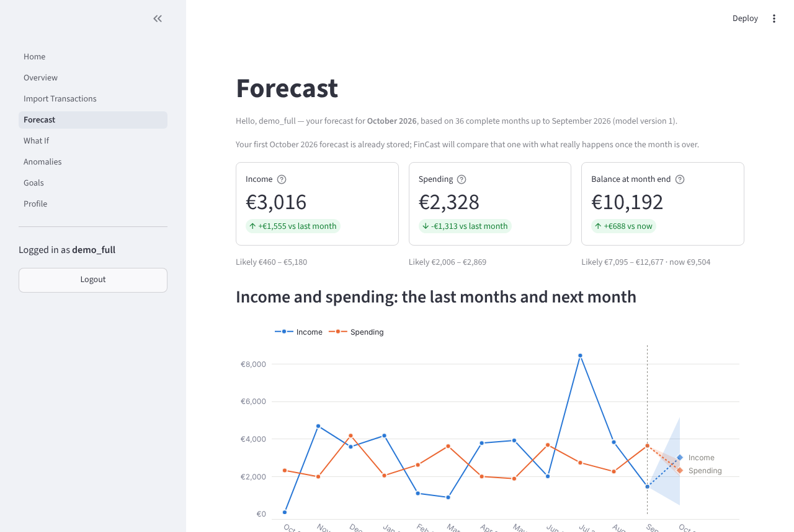
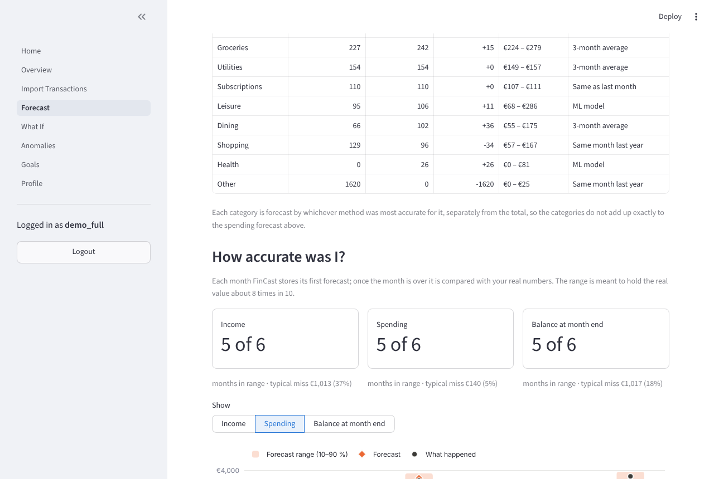
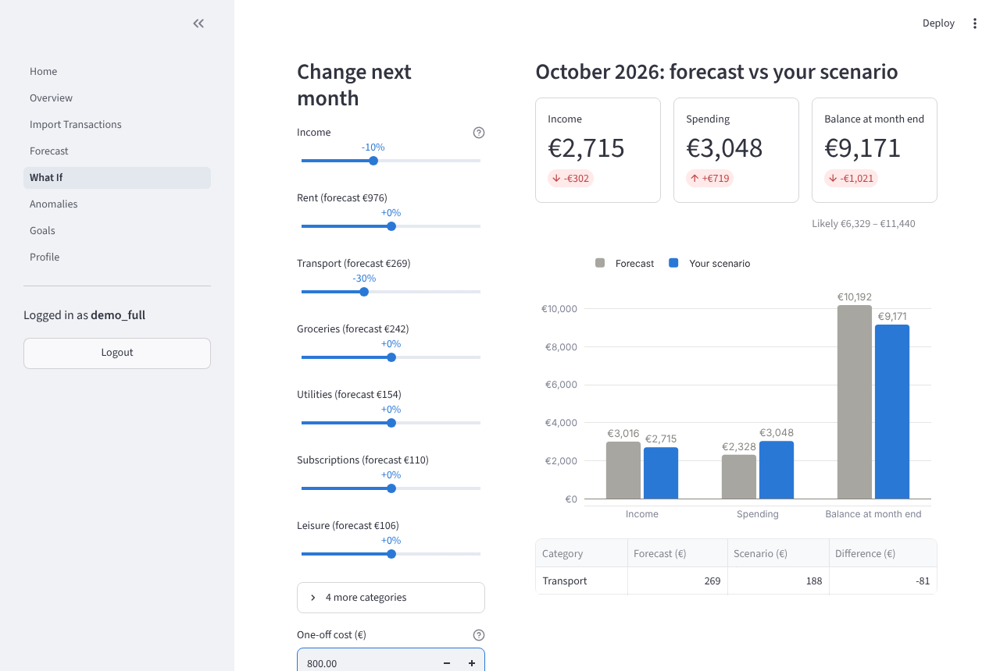
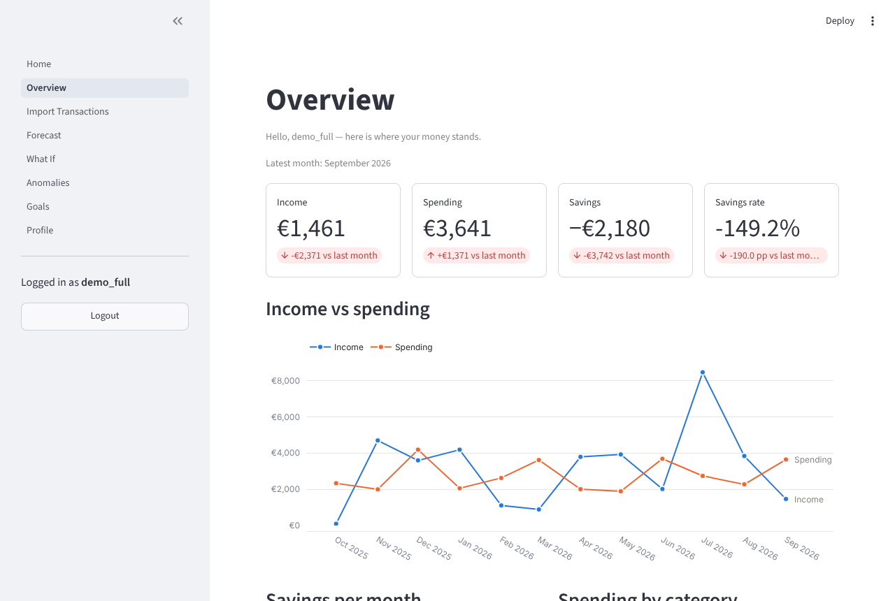
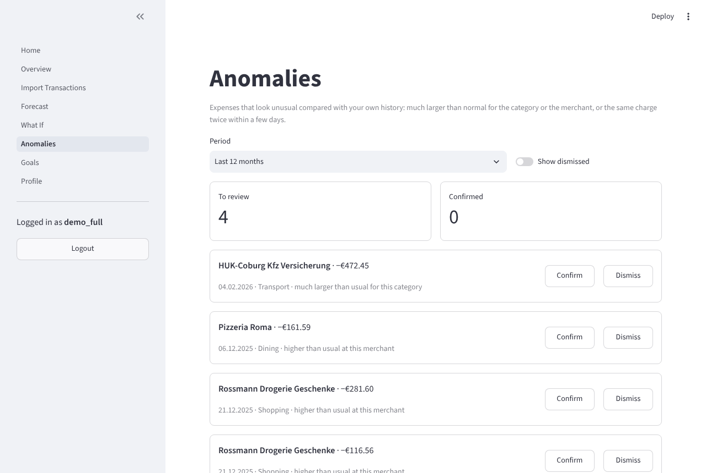
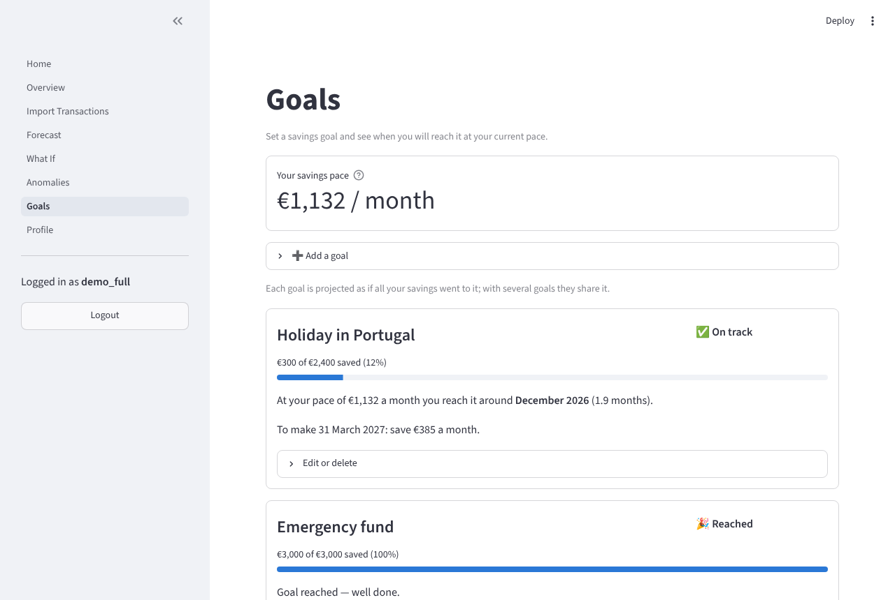
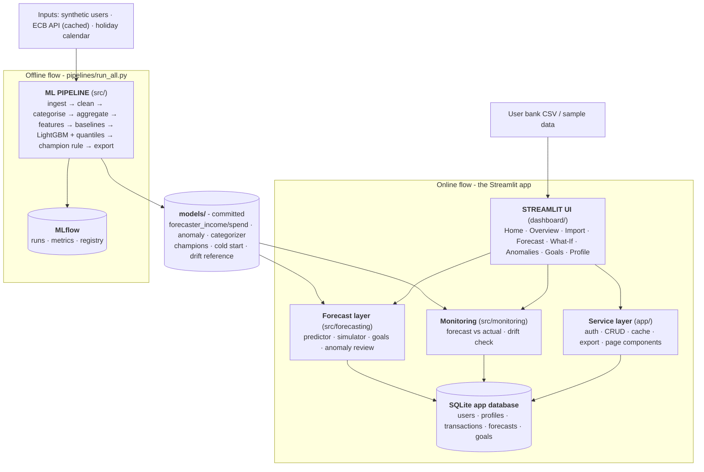
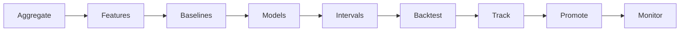

# FinCast - Predict Your Next Month's Income, Spending and Balance

FinCast is a personal finance forecaster built entirely in Python. Users import their bank transactions, and the app predicts next month's income, spending and end-of-month balance with a range. It explains the forecast, flags unusual charges and lets the user test decisions before making them.

| | |
|---|---|
| **Stack** | Python, Streamlit, SQLite, scikit-learn, LightGBM, statsmodels, MLflow, Plotly |
| **Data** | Synthetic: 300 users × 36 months, about 381,000 transactions |
| **Tests** | 289 automated tests, 92 % line coverage, including an end-to-end pipeline run |

> **Disclaimer:** FinCast is a learning and portfolio project. Forecasts are statistical estimates based on past behaviour and are **not financial advice**.

---

## Screenshots

<table>
<tr>
<td width="50%"><br><sub><b>Forecast</b> - next month with a 10-90 % range</sub></td>
<td width="50%"><br><sub><b>How accurate was I?</b> - stored forecasts vs reality</sub></td>
</tr>
<tr>
<td><br><sub><b>What-If</b> - change next month, see the balance move</sub></td>
<td><br><sub><b>Overview</b> - where the money stands</sub></td>
</tr>
<tr>
<td><br><sub><b>Anomalies</b> - unusual or duplicate charges</sub></td>
<td><br><sub><b>Goals</b> - when will I get there?</sub></td>
</tr>
</table>

---

## Features

| Feature | Description |
|---|---|
| **Next-month forecast** | Income, total spending and each spending category, each with a 10-90 % range |
| **End-of-month balance** | Expected balance plus a warning when it could go below zero |
| **Auto-categorisation** | Keyword rules first, then a TF-IDF + logistic regression classifier |
| **Anomaly detection** | Flags unusually large, new or duplicate charges for review |
| **What-If simulator** | Change income or any category and see the balance move |
| **Savings goals** | Projected completion date and an on-track indicator |
| **Forecast accuracy** | Every forecast is stored, compared with what actually happened and shown back to the user |
| **Accounts and privacy** | bcrypt-hashed passwords, per-user data, data export and account deletion |

---

## Results

Measured on a rolling backtest over 23 months (Nov 2024 - Sep 2026). Every forecast was trained only on earlier months.

| Area | Result |
|---|---|
| **Spending forecast** | Champion system MAE **€55.23** vs **€59.33** for the best simple baseline (6.9 % lower) |
| **Where the ML model wins** | Health +23 %, Leisure +19 %, Transport +15 %, Income +11 % vs the best baseline; elsewhere a baseline remains champion |
| **Forecast ranges** | The real value falls inside the 10-90 % range 85 % of the time for spending and 78 % for income |
| **Categoriser** | 100 % on held-out users; on unseen merchants only confident predictions are used (91 % correct) |
| **Anomaly detection** | 88 % of planted anomalies caught at 49 % precision |
| **Reproducibility** | A fresh clone plus `run_all.py` reproduces every model and metric exactly |

All results come from synthetic data. For real users, the *How accurate was I?* panel measures accuracy as their months come in.

---

## System Architecture

The system has two flows that meet in the `models/` folder:

- The **offline flow** (`pipelines/run_all.py`) builds the data, trains and tracks the models, and exports the champions.
- The **online flow** (the Streamlit app) reads the logged-in user's data, loads the exported models and shows the forecasts.



| Layer | Responsibility | Location |
|---|---|---|
| **Streamlit UI** | Pages, forms, charts, navigation, session handling | `dashboard/`, `app/components/` |
| **Service layer** | Registration, login, queries, categorisation, caching | `app/`, `src/preprocessing/` |
| **Forecast layer** | Load champion models, build features, predict, simulate, goals, anomaly review | `src/forecasting/` |
| **Monitoring** | Score stored forecasts against actual months, spending-mix drift check | `src/monitoring/` |
| **App database** | Users, profiles, transactions, forecasts, goals | `data/app.db` (SQLite) |
| **Model store** | Exported champion models and metadata | `models/` |
| **ML pipeline** | Ingest, clean, categorise, aggregate, features, train, backtest, track | `src/`, `pipelines/`, MLflow |

### Machine Learning Pipeline



| Stage | What happens |
|---|---|
| **Aggregate** | Transactions become monthly series per user and category |
| **Features** | Lags 1/2/3/12, rolling mean and std, month sin/cos, holidays, fixed vs variable share |
| **Baselines** | Last month, same month last year, 3-month average |
| **Models** | One global LightGBM per family (income; spending incl. categories); ETS, SARIMAX and Optuna tuning as comparisons |
| **Intervals** | Quantile models give the 10th, 50th and 90th percentile, calibrated on the backtest |
| **Backtest** | Rolling-origin time series validation; never random splits |
| **Track** | MLflow logs parameters, metrics, plots and SHAP explanations |
| **Promote** | Per series, LightGBM is champion only if it beats the best baseline by at least 10 %; the champion is registered and exported to `models/` |
| **Monitor** | Stored forecasts are compared with actual months; the spending mix is checked for drift |

New users with 3-5 months of history get wider ranges and a visible note. Fewer than 3 complete months shows a message instead of a forecast.

### Database

Every query is filtered by the logged-in `user_id`.

| Table | Purpose |
|---|---|
| `users` | Accounts; passwords stored only as bcrypt hashes |
| `profiles` | Income type, currency and opening balance |
| `transactions` | Date, description, amount, category, anomaly status and a de-duplication hash |
| `monthly_summary` | Cached monthly aggregates for fast charts |
| `forecasts` | Every forecast with its range; the actual value is filled in once the month ends |
| `goals` | Savings goals with target amount, saved amount and target date |

---

## Data

Real personal bank data is private and short, so the models are trained on **synthetic data**. 300 users across 4 types (salaried single, salaried family, freelancer, student) cover 36 months each (Oct 2023 - Sep 2026). The data includes German merchants, seasonal costs, irregular freelance income and random shocks. It is fully reproducible from a fixed seed.

Other inputs are a public holiday calendar and ECB inflation and interest-rate data. The ECB data is cached locally; the committed models were trained without it. The only real data is what a user imports into their own account.

---

## Getting Started

Requires Python 3.10-3.12. Run all commands from the project folder.

```bash
git clone https://github.com/OmPatil2806/FinCast-Predict-Your-Next-Month-s-Income-Spending-and-Balance.git
cd FinCast-Predict-Your-Next-Month-s-Income-Spending-and-Balance
python -m venv .venv
.venv\Scripts\activate            # Windows (macOS / Linux: source .venv/bin/activate)
pip install -r requirements.txt
streamlit run dashboard/Home.py
```

The trained models are committed, so the app works straight away. Register an account, open **Import transactions**, choose **Use sample data**, save, and then open **Forecast**.

| Task | Command |
|---|---|
| Rebuild all data and models (~9 min) | `python pipelines/run_all.py` |
| Only the raw data | `python pipelines/run_ingestion.py` |
| Data tables and models | `python pipelines/run_training.py` (options: `--data-only`, `--tune`, `--experiments`, `--train-categorizer`) |
| Fetch ECB data (needs internet) | `python -m src.ingestion.macro_api` |
| Run the tests | `pytest -q` |
| Coverage report | `pytest --cov=src --cov=app --cov=pipelines` |
| MLflow UI | `mlflow ui --backend-store-uri sqlite:///mlflow.db` → http://127.0.0.1:5000 |
| Logs | `logs/fincast.log` (set `FINCAST_LOG_LEVEL=DEBUG` for more detail) |

Notebooks: `notebooks/01_eda.ipynb`, `02_features.ipynb`, `03_model_experiments.ipynb`.

---

## Limitations

- **Synthetic data only.** Real users will differ; the accuracy panel and drift note make that visible.
- **Freelancer income is hard to forecast.** Typical error is about €1,600 a month, and the range holds the real value only 68 % of the time.
- **Short histories.** With 3-5 months, income errors are about 14 % higher. Spending errors are roughly double until a full year of data exists.
- **Categories do not sum to the total.** Total spending and each category use their own best method.
- **Anomalies.** About 1 in 5 subscription price rises are missed, and large first payments in a new category cannot be judged.
- **One month ahead only.** The forecast is always for the month after the last complete month.
- **No macro features yet.** The committed models were trained without ECB data.
- **Hosting.** On Streamlit Community Cloud, SQLite storage is temporary, so accounts can disappear after a restart.

---

**Disclaimer:** FinCast is a learning and portfolio project. Forecasts are statistical estimates based on past behaviour and are not financial advice.
